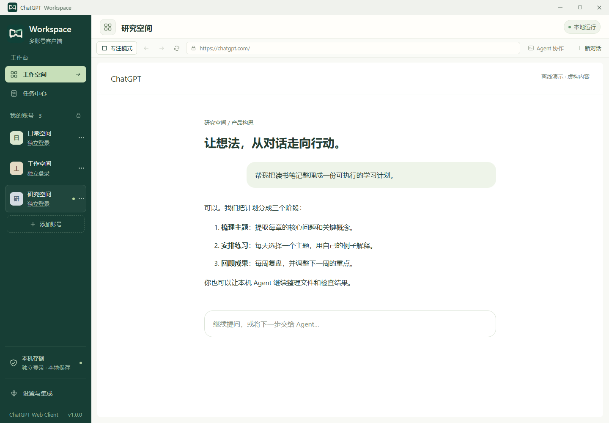
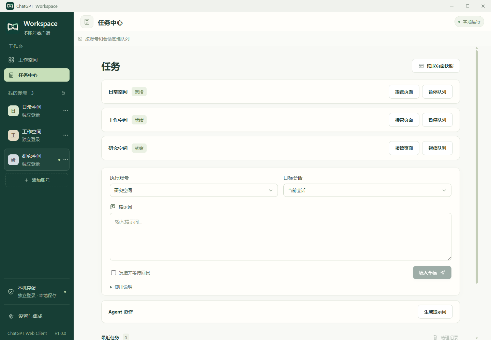
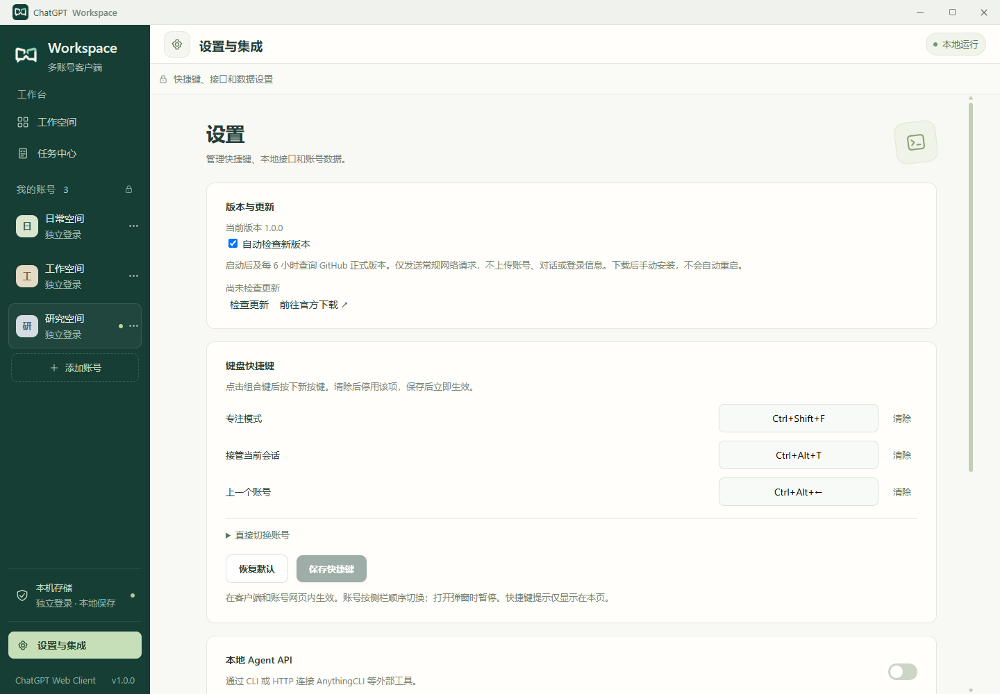

# ChatGPT Web Client

基于 Electron 的 ChatGPT 多账号桌面客户端，支持聊天、工作和 Your dot 的独立会话队列，以及会话恢复、定时发送、本地 Agent 与 HTTP / CLI 接口。

<p align="center"></p>

<p align="center"><a href="https://github.com/chenziyang110/ChatGPT-Web-Client/releases/latest">下载最新正式版</a> · <a href="docs/AGENT_COLLABORATION.md">Agent 协作指南</a> · <a href="docs/API.md">API 与 CLI</a></p>



> 图片使用独立临时环境、虚构账号和离线演示对话制作；不含真实账号、聊天记录、邮箱或登录信息。网页区域为演示内容，实际 ChatGPT 页面可能不同。

## 下载与开始

**当前正式版 v1.4.37**：前往 [Releases](https://github.com/chenziyang110/ChatGPT-Web-Client/releases/latest)，按下表选择系统和 CPU 对应的安装包。

本版新增 **清空会话队列**、**Dot 多条消息整组重复**，并修复小窗口中队列操作被输入区遮挡的问题。详见 [v1.4.37 发布说明](docs/RELEASE-v1.4.37.md)。

1. 添加账号，在独立的 ChatGPT 网页中自行登录。
2. 添加其他账号，在侧栏随时切换；各账号的登录状态互相隔离。
3. 打开一个会话，点击工具栏的 **会话队列**，提前安排后续消息；Dot 可设置定时间隔和整组重复。
4. 需要外部工具协作时，在设置中启用本地 API，再通过 **Agent 协作** 生成连接提示词。

Windows 安装包尚未配置发布者签名，可能显示未知发布者提示。请核对来源与 Release 附带的 SHA-256。v1.4.37 提供以下六种系统 / CPU 组合的安装包。

| 系统 | x64（Intel / AMD） | ARM64 | 安装包 |
| --- | --- | --- | --- |
| Windows | 支持 | 支持 | NSIS `.exe` |
| macOS | Intel Mac | Apple Silicon（M 系列） | `.dmg`、`.zip` |
| Linux | 支持 | 支持 | `.AppImage`、`.tar.gz` |

macOS 包使用 ad-hoc 签名，尚无 Developer ID 签名及公证；首次打开请参考 [macOS 安装说明](docs/MACOS.md)。Linux AppImage 可能需要 FUSE，也可使用 tar.gz 解压版。跨架构构建通过不等于目标硬件运行验证。

## 能做什么

| 功能 | 使用方式 |
| --- | --- |
| 多账号独立登录 | 最多 20 个账号，各自保存 Cookie、存储和会话，支持重命名与删除 |
| 恢复工作空间 | 重启后恢复每个账号打开的会话标签、选中项和窗口状态 |
| 快速切换账号 | 每个账号当前选中的网页保持打开，切换时直接显示；其他闲置标签可安全休眠以节省内存 |
| 打开登录或授权链接 | 在地址栏粘贴 HTTPS 链接，按 Enter 或点击箭头，在当前账号的新标签页打开 |
| 老板键 | 在系统全局用 `Ctrl+Shift+S`（macOS 为 `⌘+Shift+S`）隐藏或唤回窗口 |
| 系统托盘 | 点击窗口 × 默认隐藏到托盘，队列继续运行；单击托盘图标恢复，托盘菜单可完全退出 |
| 专注模式 | 隐藏侧栏，保留账号切换和网页工具栏；快捷键可自定义 |
| 未读回复提醒 | 账号显示生成状态和未读会话数量，并发送系统原生通知；点击通知直达对应会话 |
| 独立会话队列 | 聊天、工作和 Your dot 各自排队，支持编辑、排序、暂停、恢复与清空未开始项 |
| Dot 定时与重复发送 | 自定义间隔、重复次数，支持每行一条消息并按整组循环 |
| 任务中心 | 准备提示词、明确发送、等待回复、查看任务和页面快照 |
| 安全接管 | 遇到登录、验证、已有草稿或发送状态不明时暂停，由你处理 |
| 并行协作 | 同一会话按顺序执行；不同账号、会话独立等待回复，不占用其他会话的发送名额 |
| Agent 接口 | 本地 HTTP、JSON CLI 和跨平台 Go 工具；支持流式输出、断线续读与防重发 |
| 软件内更新 | 启动后及每 6 小时检查正式版本；Windows / Linux AppImage 支持下载、校验、安装并重启，也可明确选择强制安装 |

### 任务有进度，也能随时接管



任务中心默认只准备草稿；勾选发送后才会提交。Agent 任务遇到发送结果不明确等情况时会暂停核对。已结束记录按保留策略清理，未处理任务优先保留；这与会话队列的待发送数量不同，队列没有 30 条或 200 条的总量限制。会话队列的自动恢复规则见下文。

### 会话队列

打开目标账号和会话，点击工具栏的 **会话队列**，输入消息后点击 **加入队列**。聊天和工作会话在当前回复结束后发送下一条；页面空闲时可直接加入并发送。每个账号、每个会话分别排队，切换账号、标签页或关闭队列面板后仍按入队时的目标执行。

支持 **聊天、工作和 Your dot**。工作首页会记录模式，刷新和重启后自动恢复；Dot 绑定自己的频道。面板会显示会话所属账号及工作 / Your dot 标识，主页切换模式时草稿和队列分别保存。

#### Dot 的两种发送方式

Dot 可能先立即回复，随后继续在后台工作。在面板的 **发送方式** 中选择接续策略：

| 发送方式 | 下一条何时发送 |
| --- | --- |
| 定时发送 | 等待保存的时间间隔，不以 Dot 的即时回复或后台工作结束作为触发条件 |
| 工作结束后发送 | 等待客户端识别到 Dot 工作结束后再发送 |

定时可选 **10、20、30 分钟**或自定义 **1–1440 分钟**，点击 **保存** 生效。首次入队也等待一个间隔，后续从上一条实际确认送达时重新计时。面板显示倒计时；登录、网页验证、已有草稿或发送按钮暂不可用时会等待并重试。

间隔和到期时间保存在本机。保存设置不会解除暂停；重启或恢复时如果错过计划时间，只发送一条，然后从实际送达重新计时，不集中补发全部逾期消息。确认送达表示消息已提交，Dot 的远端工作可能仍在继续。

#### Dot 批量入队与整组重复

**发送次数**支持 **×1、×5、×10** 和自定义整数次数。普通模式将输入框里的完整内容视为一条消息，多行提示词也作为一条；选择 ×10 就追加十条相同消息。

需要一次安排多条不同消息时，勾选 **每行作为一条消息，整组重复**，每个非空行作为一条消息，行数按实际输入自动识别。例如输入：

```text
你好
你好啊
你很好啊
```

选择 **×10** 后，按以下顺序循环十轮，共加入 **30 条**：

```text
你好 → 你好啊 → 你很好啊 → 你好 → 你好啊 → 你很好啊 → …
```

三行只是示例，也可输入其他数量的消息；空行会忽略。面板实时显示识别到的消息数、整组重复次数和总条数。每条都可单独编辑、排序或移除，并沿用当前的定时或工作结束后发送策略。

整批消息一次保存，失败重试不会重复追加；已入队记录和防重复记录在重启后保留。本次应用运行期间，不同账号和会话分别保留草稿、重复次数及按行拆分选择。**每批最多 1000 条，可继续分批追加，队列总长度不受此限制。**

#### 管理与清空队列

| 操作 | 效果 |
| --- | --- |
| 消息右侧 **…** | 编辑、上移、下移或移除尚未开始的消息 |
| **暂停后续** | 暂停后续发送，当前已发送的回复继续 |
| **恢复队列** | 继续当前会话的后续消息 |
| **清空队列** | 确认后移除当前会话尚未开始的队列项，保留正在执行、已发送及需人工处理的任务 |
| **接管** | 等待本地自动操作清理完成，再交还网页控制权 |

清空仅作用于面板中显示的账号与会话。已取消项的防重复记录会保留，重试旧的批量请求不会重新创建这些消息。较矮窗口下可滚动队列面板访问确认按钮和消息操作。

任务中心的 **清理记录** 用于清理已结束的任务历史，与这里的 **清空队列** 分别操作。

#### 输入与快捷键

| 输入场景 | 入队 / 保存 | 换行 / 取消 |
| --- | --- | --- |
| 普通队列输入 | Enter，或 Ctrl/⌘+Enter 入队 | Shift+Enter 换行 |
| Dot 每行一条模式 | Ctrl/⌘+Enter 入队 | Enter 或 Shift+Enter 换行 |
| 编辑已有排队消息 | Ctrl/⌘+Enter 保存 | Enter 换行，Esc 取消编辑 |

中文输入法选词时的回车不会提交，按住提交快捷键不会重复入队。Esc 会先收起消息操作或取消清空确认，再关闭队列面板；未入队草稿在本次应用运行期间保留。

#### 中断、重试与重启恢复

会话队列会在稳定确认“无法思考”、回复报错或生成停止后结束本轮，继续后面的消息。发送前发生的临时失败会重试同一条待发送消息；已有发送记录时先恢复观察原回复，避免重发。生成完成的图片回复也会结束等待。登录、网页验证和人工草稿需要相应处理，用户主动暂停或接管的队列不会自动恢复。

“连接已中断，正在等待完整答复”并不表示远端任务已经结束。客户端会重新连接同一会话的输出，队列继续等待实际结束，详见下方的自动重连说明。

队列保存在本机。默认等待上一轮结束和等待本条回复各有 **60 分钟**预算；Dot 定时模式按保存的间隔投递。点击窗口 × 只隐藏到托盘，队列继续运行；从托盘明确退出后停止本地投递，重启后未手动暂停的后台队列自动恢复，已提交消息继续观察原回复。

观看模式自动跟随最新回复，接管后可自由浏览。聊天、工作和 Your dot 的短回复已在真实页面验证；长回复边界、整组重复、清空及重启恢复使用独立离线网页和模拟时间验证，未穷尽所有后台工具场景。参见 [批量队列验证](docs/validation/queue-bulk-2026-11-05.md)、[Work / Your dot 队列验证](docs/validation/work-dot-queues-2026-09-30.md)；接口详见 [API](docs/API.md)。

### 回复输出的自动重连

当前回复出现断线提示、停止按钮仍在，且消息正文持续 6 秒没有变化时，客户端自动重新打开同一会话，接回原任务输出。检测和等待期间保留已显示内容；输入框有未发送草稿时暂缓重连，保护正在输入的内容。

输出重连独立于队列，普通观看、暂停队列和人工接管时均可恢复输出，不会重发消息、点击停止或解除暂停。首条消息尚未生成正式会话地址时保留原页面；重连后只有空输入框不算成功，须读回原轮次。首次或较晚出现的会话加载失败会继续退避重试，最长间隔 30 秒。普通浏览中未触发输出重连的加载错误仍保留网页“重试”按钮，客户端不自动循环刷新。

此功能通过页面重连恢复输出，尚未接管 ChatGPT 私有流式接口。服务不可用时仍可能有输出间隙，不保证无缝实时显示；验证范围见 [输出重连记录](docs/validation/reply-output-reconnection-2026-10-10.md)。

### 打开登录或授权链接

在网页上方的地址栏粘贴完整的 **HTTPS 登录或授权链接**，按 **Enter** 或点击右侧箭头，会在当前账号下打开独立标签页，使用该账号的登录资料。此操作不新增队列任务，也不替换现有会话或队列；其他会话继续运行。

授权标签页可在 HTTPS 页面之间跳转。若授权链接的 `redirect_uri` 明确指定 HTTP 本机回调，只允许返回该地址的主机、端口和路径；Codex 的 `/auth/callback` 还可跳转到同一本机服务的 `/success` 成功页。在当前账号完成授权后，点击“打开 Codex”即可唤起已安装的 Codex 客户端，无需另开浏览器。支持网页跳转、服务器重定向和授权弹窗，取消后可再次操作。

临时授权地址与网页标题不写入工作空间数据库或诊断日志；未完成的授权标签页在重启后回到 ChatGPT 首页。回到稳定的 ChatGPT 页面后，恢复普通网页的导航限制。外部程序仅支持 Codex 的成功页入口或链接中明确声明的 Codex 回调，不执行网页提供的文件路径或命令。

登录页可直接人工操作。若原会话已有队列任务，登录操作不会解除其任务锁或将该会话交给手动控制。

### 设置、快捷键与版本更新



更新检查仅请求 GitHub 的公开发布信息，不上传账号、对话、Cookie 或本地 API 令牌。发现新版后点击 **下载更新**，查看下载进度；校验完成后点击 **安装并重启**，覆盖当前版本并打开新版。Windows 安装版和 Linux AppImage 支持此流程；macOS、Linux tar.gz 和开发运行保留官方下载入口。

**软件内安装更新从 v1.4.0 开始支持**。v1.3.1 及更早版本需要从 Releases 下载当前正式版并覆盖安装一次。更新不会清除账号、会话和排队消息；正在回复时可等待完成，也可明确选择 **强制安装**。强制安装仍等待本地保存完成，不重新提交已发送的消息；用户主动暂停和接管的队列在重启后保持原状态。

准备更新会显示等待本地操作或检查网页回复的阶段，总期限为 10 秒。超时后解除准备状态，保留已下载且校验通过的安装包，可再次安装；准备期间也可将当前请求改为强制安装，跳过回复检查。下载失败或校验失败可重试，不会执行不完整安装包。验证见 [更新准备记录](docs/validation/update-preparation-2026-10-10.md)。

## 运行

### 快捷键

| 操作 | Windows / Linux | macOS |
| --- | --- | --- |
| 老板键：隐藏 / 显示到前台（全局） | `Ctrl+Shift+S` | `⌘+Shift+S` |
| 进入 / 退出专注模式 | `Ctrl+Shift+F` | `⌘+Shift+F` |
| 切换到侧栏第 1–9 个账号 | `Ctrl+Alt+1…9` | `⌘+Option+1…9` |
| 上一个 / 下一个账号（首尾循环） | `Ctrl+Alt+← / →` | `⌘+Option+← / →` |

老板键在系统全局生效；其余快捷键在客户端和账号网页输入框内均可使用，打开弹窗时暂停。第 10 个及之后的账号可通过循环快捷键或专注模式的账号选择框访问。

### 启动应用

开发构建需要 **Node.js 24+**、npm、**Go 1.24+** 和可运行 Electron 的桌面系统。安装后的 Go Agent 工具在三种系统均无需 Node.js。

```sh
npm ci
npm run dev
```

渲染界面支持热更新；修改主进程/preload 后请重新启动开发命令。构建后运行：

```sh
npm run build
npm start
```

添加账号后，在它的 ChatGPT 网页中自行登录。应用不要求粘贴账号密码。任务中心默认只填写草稿，勾选发送后才提交给 ChatGPT。在设置中启用“本地 Agent API”后，外部工具才能连接。

```sh
node dist-electron/cli.cjs accounts
node dist-electron/cli.cjs browser inspect --account <account-id>
node dist-electron/cli.cjs open-link <account-id> "https://auth.example/authorize"
node dist-electron/cli.cjs open-link --account <account-id> --url "https://auth.example/authorize"
node dist-electron/cli.cjs snapshot <account-id>
node dist-electron/cli.cjs conversations add --account <account-id> --url https://chatgpt.com/c/<id> --alias daily
node dist-electron/cli.cjs prompt --account <account-id> --conversation daily --text "总结当前主题" --submit --wait --idempotency-key summary-001
node dist-electron/cli.cjs --help
```

Agent 首选原生 Go 工具（本机开发构建位于 `dist-agent/`，六目标交叉编译产物位于 `dist-agent/<platform>-<arch>/`；安装版位于应用的 `resources/agent/`，macOS 为 `.app/Contents/Resources/agent/`）。macOS / Linux 文件名为 `chatgpt-agent`，Windows 为 `chatgpt-agent.exe`：

```powershell
.\dist-agent\chatgpt-agent.exe ask --account <account-id> --new --text-file question.txt
.\dist-agent\chatgpt-agent.exe resume <task-id>
```

默认使用同一进程静默等待完整回复；需要实时文字时再加 `--stream` 逐行返回 JSON 事件，只有 `done` 表示完成。请求发送前自动保存，断线重连沿用原任务；中断后 `resume` 续读，不重复发送。

开发时也可使用 `npm run cli -- accounts`。`--data-dir PATH`（放在命令前）或 `WORKSPACE_USER_DATA` 指定与桌面端相同的数据目录。完整用法见 [docs/API.md](docs/API.md)。

## 让 Agent 借助网页 ChatGPT

1. 在目标账号的网页中登录，选好希望咨询的模型，并启用本地服务。
2. 点击网页工具栏的 **Agent 协作**，或账号管理里的 **生成 Agent 提示词**。任务中心也可按所选账号和会话生成。
3. 选择范围并复制提示词，连同你的具体任务交给能在本机运行命令或访问本地接口的 Agent。
4. Agent 调用提示词中的原生 `chatgpt-agent` 工具，工具负责发送、静默阻塞等待、按需流式输出和断线续读，Agent 拿到完整回答后验证建议并继续原任务。执行时可看只读实时预览；遇到草稿、登录或验证时，界面让你选择接管处理、继续原任务或取消。

选择账号会在首次咨询时新建会话，后续追问沿用它；选择会话会固定目标，之后切换网页不影响提示词中的目标。生成和复制不会发送消息，也不会自动开启服务。模型由网页设置决定，提示词不能将账号升级或自动切换到高级模型。

完整说明见 [Agent 协作](docs/AGENT_COLLABORATION.md)。

## 数据与权限

| 系统 | 默认数据目录 |
| --- | --- |
| macOS | `~/Library/Application Support/ChatGPT-Web-Client` |
| Windows | `%APPDATA%/ChatGPT-Web-Client` |
| Linux | `$XDG_CONFIG_HOME/ChatGPT-Web-Client`，未设置时为 `~/.config/ChatGPT-Web-Client` |

`workspace.sqlite` 保存账号、会话、任务及设置；Electron 在独立的 `Partitions/account-<uuid>` 目录保存浏览器资料。删除账号会清除浏览器存储、缓存、HTTP 鉴权和该账号任务记录。

网页没有 Node.js、preload 或 IPC 权限。本地界面使用独立分区，IPC 校验发送者、主 frame 和精确 URL。API 默认关闭，仅监听 `127.0.0.1`，操作接口要求随机令牌并拒绝浏览器 Origin/Fetch Metadata 与非预期 Host；help.html / help.json 是不含私密数据的公开本机说明页。

启用 API 后的 `agent-runtime.json` 包含地址及令牌，关闭时删除，每次启动轮换。POSIX 下文件权限为 `0600`、数据目录为 `0700`；Windows 使用用户配置目录的 ACL。同一系统用户下能访问这些文件的进程仍属于信任边界。不要上传或提交浏览器资料、数据库和连接配置。

任务输入和结果仅保存在本机，可在任务中心清理已结束记录。防重发用的最小请求键、摘要与任务 ID 会保留到删除账号；升级前备份可能包含旧任务内容。显式发送的内容会进入 ChatGPT 服务。本项目不暴露任意 JavaScript、shell 执行或 Cookie 导出接口。

## 测试与打包

```sh
npm test                 # 核心、持久化、HTTP 和 CLI
npm run build            # 类型检查与全部编译产物
npm run test:desktop     # 真实 Electron，离线页面 fixture，需要桌面显示
npm run pack             # 当前平台的应用目录
npm run dist             # 当前系统、当前架构
npm run dist:win         # Windows x64 + ARM64
npm run dist:mac         # macOS x64 + ARM64（在 Mac 上运行）
npm run dist:linux       # Linux x64 + ARM64（建议在 Linux 上运行）
npm run build:agent:all  # 交叉编译六种原生 Agent
```

Linux 无头测试：`xvfb-run --auto-servernum npm run test:desktop`。一次性 CI 测试程序使用 `--no-sandbox`；正式应用保持沙箱。GitHub Actions 配置了三平台检查/打包和 Linux 桌面测试。发布矩阵覆盖三个系统的 x64 / ARM64；代码签名、公证和发布凭据不在仓库中。更新使用公开 Release 和按架构生成的校验清单。发布流程见 [发布指南](docs/RELEASING.md)。

## 已知边界

- ChatGPT 登录、订阅、验证码、网络可用性由对应服务决定。第三方 OAuth 可能拒绝嵌入式浏览器；本项目不绕过服务限制。
- 队列已支持聊天、工作和 Your dot；会话列表是本地登记记录。项目、自定义 GPT、临时及分享会话的自动化支持，以及云端历史批量导入与完整同步暂未实现。
- 提示词自动化依赖 ChatGPT 的 DOM 属性。网页变化、工具调用或慢回复可能导致失败/超时。取消或超时不会撤回已经发送的内容，也不保证停止网页端生成。
- 麦克风、摄像头等网页权限默认关闭。下载通过原生保存对话框处理。最多 20 个账号；打开的账号会占用各自的 Chromium 资源。
- AnythingCLI 的集成方式是标准子进程 CLI 或 HTTP，没有假设其未公开的原生插件协议。
- MCP、插件生态和多服务商是需求文档中的后续扩展。

详见 [架构](docs/ARCHITECTURE.md)、[路线](docs/ROADMAP.md) 和 [验证记录](docs/VALIDATION.md)。本项目独立开发，与 OpenAI 无隶属关系。

## 文档索引

- 使用与开发：[Agent 协作](docs/AGENT_COLLABORATION.md)、[API 与 CLI](docs/API.md)、[发布流程](docs/RELEASING.md)、[macOS 安装](docs/MACOS.md)
- 产品与技术：[产品需求](docs/PRODUCT_REQUIREMENTS.md)、[会话自动化方案](docs/CONVERSATION_AUTOMATION_PROPOSAL.md)、[架构](docs/ARCHITECTURE.md)、[技术栈](docs/TECH_STACK.md)、[路线图](docs/ROADMAP.md)、[验证记录](docs/VALIDATION.md)
- 视觉与平台记录：[视觉规范](docs/BRAND.md)、[macOS 签名调查](docs/MACOS-SIGNATURE-INVESTIGATION.md)
- 发布记录：[v1.0.0](docs/RELEASE-v1.0.0.md)、[v1.1.0](docs/RELEASE-v1.1.0.md)、[v1.1.1](docs/RELEASE-v1.1.1.md)、[v1.2.0](docs/RELEASE-v1.2.0.md)、[v1.3.0](docs/RELEASE-v1.3.0.md)、[v1.3.1](docs/RELEASE-v1.3.1.md)、[v1.4.0](docs/RELEASE-v1.4.0.md)、[v1.4.1](docs/RELEASE-v1.4.1.md)、[v1.4.2](docs/RELEASE-v1.4.2.md)、[v1.4.3](docs/RELEASE-v1.4.3.md)、[v1.4.4](docs/RELEASE-v1.4.4.md)、[v1.4.5](docs/RELEASE-v1.4.5.md)、[v1.4.6](docs/RELEASE-v1.4.6.md)、[v1.4.7](docs/RELEASE-v1.4.7.md)、[v1.4.8](docs/RELEASE-v1.4.8.md)、[v1.4.9](docs/RELEASE-v1.4.9.md)、[v1.4.10](docs/RELEASE-v1.4.10.md)、[v1.4.11](docs/RELEASE-v1.4.11.md)、[v1.4.12](docs/RELEASE-v1.4.12.md)、[v1.4.13](docs/RELEASE-v1.4.13.md)、[v1.4.14](docs/RELEASE-v1.4.14.md)、[v1.4.29](docs/RELEASE-v1.4.29.md)、[v1.4.31](docs/RELEASE-v1.4.31.md)、[v1.4.34](docs/RELEASE-v1.4.34.md)、[v1.4.35](docs/RELEASE-v1.4.35.md)、[v1.4.37](docs/RELEASE-v1.4.37.md)

## 账号会话通知与快捷键

账号头像旁的转圈表示该账号的会话正在生成回复；消息气泡按有未读回复的会话数计数。同一会话连续完成多轮仍计 1 个，不同会话分别累加。点击气泡直接打开最近一个可查看的未读会话；看过后气泡数字减少，再点可查看下一个。正在回复的会话要等结束后才能通过气泡打开。直接在前台查看准确的会话也会自动消除对应提醒。切换账号不会清空其他会话，窗口隐藏、失焦或 Agent 只读预览不算已查看；未读状态会在重启后保留。系统通知只提示账号有未读回复，不展示会话内容。

通知覆盖客户端中已打开的账号页面（包括切到其他账号后的后台页面）和任务队列。打开历史对话不会产生新通知。不监控外部浏览器或尚未打开的云端会话；在同一账号内导航离开正在生成的页面后，原页面的完成状态无法继续观察。未读回复通知依赖已支持的网页完成标记；错误和未知状态不会产生完成通知。

侧栏、账号按钮提示和专注模式按钮不显示快捷键组合。进入“设置与集成 → 键盘快捷键”可录入、清除或恢复默认，保存后立即对主界面和账号网页生效，重启保留。重复绑定会阻止保存；快捷键只在应用内生效。

执行期间点击 **接管**，客户端会先停止本地自动操作，再交还网页控制权；设置中可配置接管快捷键。尚未发送的任务可处理后继续，已经发送或结果不确定的任务需核对，不会重复发送。
